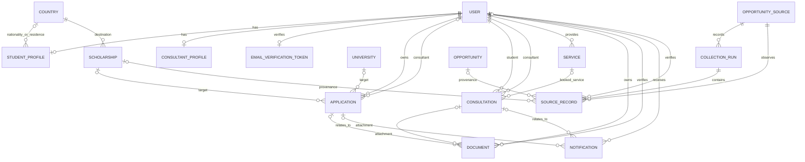

# Gofer Exam Database Architecture Audit

**Audit date:** 2026-11-11
**Scope:** Checked-in Django models, migrations, serializers, views, services,
admin configuration, and API route registration. This is a source-code audit,
not a production database inspection.

## Executive summary

The backend has 13 domain apps and 17 application-owned Django models. Its
relational core covers users, profiles, scholarships, opportunities, academic
institutions, student application tracking, consultations, services,
notifications, and a country registry. The API uses Django REST Framework,
cookie JWT authentication, global page-number pagination, and per-view
search/filter/order settings.

Existing migrations are present for all 13 domain apps. The model layer is not
the production schema evidence: no production database was queried, no applied
migration state was inspected, and no backup or restore was tested. Do not infer
that these tables or current rows match a hosted database.

### Feature status rule

“Implemented” below means code/model or workflow is present in the repository.
“Deployed” means running in the intended production service. “Verified” means
tested against that production service with appropriate real-world evidence.
This audit can establish implementation only. **Deployed: not established.
Verified in production: not established.** Earlier public checks reported
zero visible catalogues and a live API schema mismatch; those observations do
not identify the live database’s contents or migration state.

## Architecture and API boundaries

- **Authentication and identity:** `accounts.User` is the custom user model
  (`AUTH_USER_MODEL = 'accounts.User'`), with email as username, role-based
  access, Django permission M2Ms, and a separate email-verification token row.
- **Student and consultant profiles:** one-to-one profile tables extend the
  user record. They are separate models, not multi-table inheritance.
- **Reference data:** `common.Country` is the only shared normalized catalog
  entity. Several other country and field-of-study values remain text or JSON.
- **Catalogues:** scholarships and universities have separate tables;
  destinations and services are independent tables. General opportunities,
  source configuration, collection runs, and source observations are in the
  opportunities app.
- **Overlap:** no exact duplicate domain models were found. There is deliberate
  subject overlap (scholarships are specialized records while Opportunities
  cover non-scholarship records; consultant profiles extend Users). The larger
  risk is duplicated representations of concepts—especially country,
  field/program, and application status—not duplicate tables.
- **Student workflows:** applications point to a university or scholarship;
  consultations point to a student, consultant, and optionally a service;
  documents point to a user and optionally an application/consultation;
  notifications can point to an application/consultation.
- **API routes:** `config/urls.py` mounts `/api/v1/auth/`,
  `/applications/`, `/consultations/`, `/notifications/`, `/scholarships/`,
  `/countries/`, `/opportunities/`, `/services/`, `/universities/`,
  `/destinations/`, and `/students/`, plus schema/docs routes. There is no
  mounted documents API and no standalone consultants route. Consultant
  directory data is exposed under `/consultations/consultants/`.
- **API defaults:** global DRF pagination is page-number based at 20 rows;
  global search and ordering backends are enabled. Countries and consultant
  directory explicitly disable pagination. Viewsets add their own filter
  fields and lookup keys.

## Model-by-model inventory

Every listed model has a Django migration. All model registrations were
confirmed from Django's app/admin registry using test settings. Unless noted,
all relationships below are database foreign keys and validators/choices are
Django model/serializer validation, not PostgreSQL check constraints. Index
lists refer to explicitly declared model indexes; Django also creates indexes
for foreign keys unless disabled.

### `accounts` — [`models.py`](./backend/apps/accounts/models.py)

#### `User`

- **Fields/types:** `id` UUID PK; `email` unique `EmailField`; `password`
  hashed `CharField`; `first_name`, `last_name` (`CharField`), `phone_number`
  (`CharField`), `role` (`CharField` choice); `is_active`, `is_staff`,
  `is_superuser`, `is_verified` (`BooleanField`); `date_joined`, `last_login`,
  `updated_at` (`DateTimeField`, `last_login` nullable); Django `groups` and
  `user_permissions` M2Ms.
- **Relationships:** Django permissions M2Ms; reverse one-to-one student and
  consultant profiles; reverse FKs from applications, consultations,
  documents, notifications, and services/source verification records.
- **Uniqueness/indexes:** unique email; explicit indexes on email, role, and
  active status. Email has both uniqueness and a separately declared index,
  which may be redundant for the database.
- **Validation:** `EmailValidator`; role choices; manager trims/lowercases the
  whole email on `create_user`; staff/superuser flags checked by
  `create_superuser`. Role/verification invariants are not DB constraints.
- **API/admin:** register/login/logout/token refresh/current-user endpoints;
  staff-only Django admin registered.
- **Missing/risks:** no database constraint tying role to matching profile;
  direct ORM/admin writes can create mismatches. Role choice validation is not
  a database check. No profile creation signal is assumed; student profile
  endpoint creates on demand.

#### `EmailVerificationToken`

- **Fields/types:** `id` `BigAutoField` PK; `user` one-to-one FK;
  `token_hash` unique `CharField(64)`; `created_at`, `expires_at`,
  `last_sent_at` (`DateTimeField`); nullable `used_at` (`DateTimeField`).
- **Relationships/deletion:** user `CASCADE`; one active token row per user.
- **Uniqueness/indexes:** one-to-one uniqueness on user, unique hash, index on
  expiry.
- **Validation:** token issuance/expiry/single-use logic is in the account
  verification service rather than a DB constraint.
- **API/admin:** used by verify/resend auth endpoints; not registered in
  Django admin.
- **Migrations:** `accounts.0001_initial`, `accounts.0002_emailverificationtoken`.
- **Missing/risks:** cleanup policy for expired rows is not represented by the
  model. Token lifecycle enforcement depends on service code and transactions.

### `students` — [`models.py`](./backend/apps/students/models.py)

#### `StudentProfile`

- **Fields/types:** `id` UUID PK; `user` one-to-one FK; `date_of_birth`
  nullable `DateField`; `gender`, `nationality`, `passport_number`, `city`,
  `country`, `postal_code`, `emergency_contact_name`,
  `emergency_contact_phone`, `emergency_contact_relationship`,
  education level/school/field, target degree, budget, English test type/score
  (`CharField`), `address` (`TextField`); `nationality_country`,
  `residence_country` nullable Country FKs; `graduation_year` nullable
  `IntegerField`; `gpa` nullable `DecimalField`; `target_countries`,
  `preferred_fields` (`JSONField` lists); `gre_score`, `gmat_score`,
  `sat_score`, `reward_points` (`IntegerField`); `profile_completed`,
  `is_active_applicant` (`BooleanField`); `created_at`, `updated_at`
  (`DateTimeField`).
- **Relationships/deletion:** user `CASCADE`; country references `SET_NULL`.
- **Uniqueness/indexes:** one-to-one user; indexes on user, legacy country
  string, and education level.
- **Validation:** graduation year 1950–2050; GPA 0–4; serializer normalizes
  and validates target country codes against active Country rows and uses
  active Country references for nationality/residence. Profile completion is
  derived in serializer/model helper.
- **API/admin:** authenticated self GET/PATCH and completion endpoint; admin
  registered.
- **Migrations:** initial plus `students.0002_studentprofile_nationality_country_and_more`.
- **Missing/risks:** legacy free-text nationality/residence country remain
  alongside FKs; target degree, preferred fields, and test score formats are
  not normalized. GRE/GMAT/SAT values have no model validators or score-scale
  metadata.

### `consultants` — [`models.py`](./backend/apps/consultants/models.py)

#### `ConsultantProfile`

- **Fields/types:** `id` UUID PK; `user` one-to-one FK; `company_name`,
  `job_title`, `availability_hours`, `timezone`, `website_url`, `linkedin_url`,
  `twitter_url` (`CharField`); `bio` (`TextField`); `profile_image`
  nullable `ImageField`; `specializations`, `languages`, `expertise_countries`,
  `expertise_fields`, `verification_documents` (`JSONField` lists);
  `years_of_experience`, `total_consultations`, `total_students_helped`
  (`IntegerField`); `consultation_rate`, `average_rating`, `success_rate`
  (`DecimalField`); `verification_status` (`CharField` choice);
  `is_available`, `is_featured` (`BooleanField`); `created_at`, `updated_at`
  (`DateTimeField`) and nullable `verified_at` (`DateTimeField`).
- **Relationships/deletion:** user `CASCADE`; reverse consultation/service
  references use `accounts.User`, not this profile row.
- **Uniqueness/indexes:** one-to-one user; indexes on user, verification,
  availability, featured, average rating.
- **Validation:** experience 0–50; rate nonnegative; rating 0–5; success rate
  0–100. Verification timestamps/status consistency is not DB-enforced.
- **API/admin:** read-only consultant-directory serializer/view under
  `/api/v1/consultations/consultants/` for verified and available active users;
  admin registered. The app itself has no URL module or serializer.
- **Migrations:** initial.
- **Missing/risks:** free-text availability is not a schedule; JSON
  verification-document URLs are not document FKs. Statistics are mutable
  counters and `update_statistics` does not calculate ratings from persisted
  reviews (there is no review model).

### `scholarships` — [`models.py`](./backend/apps/scholarships/models.py)

#### `Scholarship`

- **Fields/types:** `id` UUID PK; `name`, unique `slug`, `short_description`,
  `provider`, `country`, `amount_type` (`CharField`); `description`
  (`TextField`); nullable `provider_logo` (`ImageField`);
  nullable `country_reference` Country FK; `type`, `level`, `status`,
  `nationality_eligibility` (`CharField` choices); `amount`, nullable
  `required_gpa`, `success_rate` (`DecimalField`); `eligibility`, `fields`,
  `target_countries`, `excluded_countries`, `documents_required`, `benefits`
  (`JSONField` lists); `application_deadline` (`DateField`);
  `application_url`, `website_url` (`URLField`), `contact_email`
  (`EmailField`); `is_published`, `is_featured`, `is_popular`
  (`BooleanField`); `view_count`, `application_count` (`IntegerField`);
  `created_at`, `updated_at` (`DateTimeField`) and nullable
  `published_at` (`DateTimeField`).
- **Relationships/deletion:** `country_reference` to Country with
  `SET_NULL`; reverse source records and applications.
- **Uniqueness/indexes:** unique slug; indexes on country string, country FK,
  type, level, status, featured, deadline, slug, nationality-eligibility.
- **Validation:** amount >= 0; GPA 0–4; success rate 0–100. Serializer validates
  target/excluded country codes against active Country rows and disallows
  overlap; `SPECIFIC` nationality mode requires targets. Publishing invokes
  model validation for linked source records. Model save does not run
  `full_clean` generally; validation is not a DB constraint.
- **API/admin:** public read-only list/detail by slug and authenticated
  eligible-for-me endpoint; published records are hidden if linked sources
  are invalid. Filters: country, type, level, status, featured; search and
  ordering available; admin registered with publish/unpublish actions.
- **Migrations:** `0001_initial`, `0002_scholarship_is_published`,
  `0003_scholarship_country_reference_and_more`.
- **Missing/risks:** no relational field-of-study catalog or award-to-university
  program relation; nationality lists and eligibility/documents remain JSON.
  Destination country is duplicated as string and FK. Admin bulk actions use
  queryset updates for non-publish changes; publication rules live partly in
  Python and source-query filtering, not DB constraints.

### `universities` — [`models.py`](./backend/apps/universities/models.py)

#### `University`

- **Fields/types:** `id` UUID PK; `name`, unique `slug`, `country`, `city`,
  `type`, `phone_number` (`CharField`); `description`, `address`
  (`TextField`); nullable `founded_year`, `world_ranking`, `national_ranking`
  (`IntegerField`); `total_students`, `international_students`, `view_count`,
  `application_count` (`IntegerField`); nullable `image`, `logo`
  (`ImageField`); nullable `acceptance_rate`, `tuition_fee`, `minimum_gpa`
  (`DecimalField`); `application_fee` (`DecimalField`);
  `programs`, `popular_majors`, `required_tests` (`JSONField` lists);
  `website_url` (`URLField`), `admissions_email` (`EmailField`);
  `is_featured`, `is_partner` (`BooleanField`); `created_at`, `updated_at`
  (`DateTimeField`).
- **Relationships:** no foreign keys; programs are embedded JSON rather than
  separate academic-program records.
- **Uniqueness/indexes:** unique slug; indexes on country, city, type,
  featured, world ranking, slug.
- **Validation:** year 1000–2100; rankings >= 1; counts/fees >= 0;
  acceptance 0–100; minimum GPA 0–4. Model does not use a normalized Country
  FK.
- **API/admin:** public read-only list/detail by slug; filters country, city,
  type, featured, partner; search/order; admin registered.
- **Migrations:** initial.
- **Missing/risks:** no relational academic programs, degrees, campuses,
  program-specific admission requirements, or normalized country relation.
  Rankings/program JSON have no structured source/provenance model.

### `destinations` — [`models.py`](./backend/apps/destinations/models.py)

#### `Destination`

- **Fields/types:** `id` UUID PK; unique `name`, unique `slug`, `flag_emoji`,
  `post_study_work_duration`, `primary_language`, `visa_processing_time`,
  `scholarship_availability` (`CharField`); `description` (`TextField`);
  nullable `image`, `banner_image` (`ImageField`); `total_universities`,
  `international_students`, `work_hours_per_week`, `view_count`,
  `scholarship_count` (`IntegerField`); nullable `popularity_rank`
  (`IntegerField`); `education_quality_rating`, `average_tuition_fee`,
  `average_living_cost`, nullable `visa_approval_rate` (`DecimalField`);
  `work_while_studying`, `post_study_work_visa`, `is_popular`,
  `is_featured`, `english_required` (`BooleanField`);
  `required_tests`, `highlights` (`JSONField` lists);
  `official_education_website`, `embassy_website` (`URLField`);
  `created_at`, `updated_at` (`DateTimeField`).
- **Relationships:** no FKs to Country, University, or Scholarship; counts
  are stored scalar values.
- **Uniqueness/indexes:** unique name and slug; indexes on name, popular,
  featured, rank, slug.
- **Validation:** rank >= 1; student/work counts nonnegative; work hours
  0–40; rating 0–5; cost nonnegative; visa approval 0–100.
- **API/admin:** public read-only list/detail by slug; filters popular,
  featured, English required, work-while-studying; search/order; admin
  registered.
- **Migrations:** initial.
- **Missing/risks:** denormalized counts may drift and country attributes
  overlap the Country registry; values such as costs, visa rates, and
  highlights have no effective-date/source history.

### `services` — [`models.py`](./backend/apps/services/models.py)

#### `Service`

- **Fields/types:** `id` UUID PK; `title`, unique `slug`, `short_description`,
  `category`, `currency`, `duration` (`CharField`); `description`
  (`TextField`); `price` (`DecimalField`); `features` (`JSONField` list);
  nullable `consultant` User FK; `is_active`, `is_featured` (`BooleanField`);
  nullable `image` (`ImageField`); `view_count`, `purchase_count`
  (`IntegerField`); `created_at`, `updated_at` (`DateTimeField`).
- **Relationships/deletion:** consultant User FK uses `CASCADE`; reverse
  consultations can reference a service with `SET_NULL`.
- **Uniqueness/indexes:** unique slug; indexes category, consultant, active,
  featured, slug.
- **Validation:** price >= 0; consultant role is limited in admin choices,
  not DB-constrained.
- **API/admin:** public read-only active-service catalogue and detail by slug;
  category/featured filters, search/order; admin registered.
- **Migrations:** initial.
- **Missing/risks:** no service purchase/order/payment model. `purchase_count`
  has no corresponding transaction relation. Currency format is a string,
  with no supported-currency validation.

### `applications` — [`models.py`](./backend/apps/applications/models.py)

#### `Application`

- **Fields/types:** `id` UUID PK; required `student` User FK; `application_type`,
  `status` (`CharField` choices); nullable `university` and `scholarship` FKs;
  `program_name`, `degree_level`, `application_id` (`CharField`);
  nullable `submission_date` (`DateTimeField`), `deadline_date`,
  `decision_date` (`DateField`); `application_url` (`URLField`);
  nullable `consultant` User FK; `notes`, `admin_notes` (`TextField`);
  `status_updates` (`JSONField` list); `email_notifications` (`BooleanField`);
  `created_at`, `updated_at` (`DateTimeField`).
- **Relationships/deletion:** student User `CASCADE`; university and
  scholarship `SET_NULL`; consultant User `SET_NULL`; reverse documents and
  notifications `CASCADE` when application is deleted.
- **Uniqueness/indexes:** no unique constraints; indexes student, status,
  type, university, scholarship, consultant, deadline.
- **Validation:** serializer enforces exactly one university for type
  `UNIVERSITY` or one published scholarship for `SCHOLARSHIP`; blocks client
  edits to managed workflow fields; only drafts are editable, and submit/
  withdraw actions enforce limited transitions. These target/type rules are
  not DB constraints. Status updates are JSON, not an append-only event table.
- **API/admin:** authenticated student CRUD/list/retrieve plus submit/withdraw;
  consultant assigned list and start-review; admin overview; registered in
  admin.
- **Migrations:** initial.
- **Missing/risks:** applications cannot target general Opportunities.
  Consultant/admin transition paths and admin bulk operations can bypass
  centralized transition logic. No uniqueness rule prevents duplicate active
  applications to the same target. “Submitted” changes Gofer tracking state;
  it does not transmit to a university/provider.

### `consultations` — [`models.py`](./backend/apps/consultations/models.py)

#### `Consultation`

- **Fields/types:** `id` UUID PK; required `student`, `consultant` User FKs;
  nullable `service` FK; `type`, `status`, `title`, `timezone`, `meeting_id`,
  `meeting_password` (`CharField`); `description`, `student_notes`,
  `consultant_notes`, `student_feedback` (`TextField`);
  `scheduled_date` (`DateField`), `scheduled_time` (`TimeField`),
  `duration_minutes`, nullable `student_rating` (`IntegerField`);
  `meeting_url` (`URLField`); `is_paid`, `reminder_sent` (`BooleanField`);
  `payment_amount` (`DecimalField`); `action_items` (`JSONField` list);
  `reminder_sent_at`, `completed_at` nullable and `created_at`, `updated_at`
  (`DateTimeField`).
- **Relationships/deletion:** student and consultant User FKs `CASCADE`;
  service FK `SET_NULL`; reverse documents/notifications `CASCADE`.
- **Uniqueness/indexes:** no unique constraints; indexes student, consultant,
  status, scheduled date, paid.
- **Validation:** duration 15–480 minutes; nonnegative payment; rating 1–5.
  Serializer validates IANA timezone, future requests, and overlapping
  pending/confirmed bookings while locking the consultant row. No DB
  exclusion constraint prevents concurrent overlap independently of that
  locking strategy.
- **API/admin:** student create/list/retrieve/cancel/feedback; verified
  consultant directory; consultant assigned list and confirm/cancel/complete
  actions; admin registered.
- **Migrations:** initial.
- **Missing/risks:** payment status is represented by booleans/amount without
  payment ledger/provider IDs; no durable schedule/availability model,
  reminders worker, audit event stream, or calendar integration.

### `documents` — [`models.py`](./backend/apps/documents/models.py)

#### `Document`

- **Fields/types:** `id` UUID PK; required `user` User FK; `document_type`,
  `title`, `file_extension` (`CharField`); `description`,
  `verification_notes` (`TextField`); `file` (`FileField`);
  `file_size` (`IntegerField`); nullable `application`, `consultation` FKs;
  nullable `verified_by` User FK; `status` (`CharField` choice);
  nullable `expiry_date` (`DateField`); `is_confidential` (`BooleanField`);
  `created_at`, `updated_at` (`DateTimeField`) and nullable `verified_at`.
- **Relationships/deletion:** user `CASCADE`; application and consultation
  `CASCADE`; verifier `SET_NULL`.
- **Uniqueness/indexes:** no unique constraints; indexes user, type, status,
  application, consultation.
- **Validation:** extension validator allows PDF, DOC/DOCX, JPG/JPEG, PNG.
  Save records size/extension; no model-level file size, content/MIME
  inspection, or owner-consistency validation.
- **API/admin:** **not exposed through a mounted API** (views contain no
  document endpoint and there is no serializer/URL module); registered in
  Django admin.
- **Migrations:** initial.
- **Missing/risks:** no student upload/download/delete workflow, ownership
  authorization endpoint, private durable storage guarantee, malware scan, or
  retention policy. The database row does not ensure the linked application
  or consultation belongs to the same `user`; deleting those parent records
  cascades document rows and file cleanup needs storage-level verification.

### `notifications` — [`models.py`](./backend/apps/notifications/models.py)

#### `Notification`

- **Fields/types:** `id` UUID PK; required `user` User FK; `type`, `priority`,
  `title`, `action_url`, `action_text` (`CharField`); `message` (`TextField`);
  `is_read`, `send_email`, `email_sent` (`BooleanField`);
  nullable `read_at`, `email_sent_at` (`DateTimeField`);
  nullable `application`, `consultation` FKs; `created_at` (`DateTimeField`).
- **Relationships/deletion:** user/application/consultation all `CASCADE`.
- **Uniqueness/indexes:** no unique constraints; indexes `(user, is_read)`,
  `(user, created_at)`, type, priority.
- **Validation:** choices at Django layer; no DB consistency check between
  `is_read` and `read_at`, or email flags and `email_sent_at`.
- **API/admin:** authenticated list/retrieve/read/read-all/unread-count scoped
  to the current user; admin registered.
- **Migrations:** initial.
- **Missing/risks:** no delivery-attempt/outbox model, retries, provider
  message ID, or audit trail; email flags do not themselves implement email
  delivery.

### `opportunities` — [`models.py`](./backend/apps/opportunities/models.py)

#### `OpportunitySource`

- **Fields/types:** `id` UUID PK; `name`, `organization`, unique `base_url`,
  `source_type`, `collection_method`, `terms_url`, `robots_url`,
  `reliability_status`, `last_error_code` (`CharField`); `last_error_message`
  (`TextField`); `is_active` (`BooleanField`); `collection_interval_hours`
  (`PositiveIntegerField`); nullable `last_success_at`, `last_failure_at`
  (`DateTimeField`); `created_at`, `updated_at` (`DateTimeField`).
- **Relationships:** reverse collection runs and source observations.
- **Uniqueness/indexes:** unique base URL; indexes active+reliability,
  source type, last success.
- **Validation:** HTTP/HTTPS URL validation and URL normalization; interval
  >= 1; last failure cannot precede last success; disabled source cannot be
  active. Save deactivates publication of linked public records when source
  is disabled.
- **API/admin:** no public CRUD endpoint; staff Django admin registered.
- **Migrations:** opportunities initial and subsequent migrations.
- **Missing/risks:** no actual collector/scheduler implementation was found in
  this model/API audit; source eligibility/cadence is configuration, not proof
  of collection.

#### `CollectionRun`

- **Fields/types:** `id` UUID PK; required `source` FK; `trigger_type`,
  `status`, `collector_version` (`CharField`); `started_at` (`DateTimeField`),
  nullable `finished_at`; `records_seen`, `records_created`,
  `records_updated`, `records_unchanged`, `records_flagged_duplicate`,
  `records_rejected`, `error_count` (`PositiveIntegerField`);
  `error_summary`, `request_metadata` (`JSONField` objects).
- **Relationships/deletion:** source `PROTECT`; reverse source records.
- **Uniqueness/indexes:** no unique constraints; indexes source+start and
  status+start.
- **Validation:** JSON payload must be bounded object; finish cannot precede
  start; running rows cannot have finish time; completed rows require finish.
- **API/admin:** no API endpoint; admin registered and fields read-only.
- **Migrations:** opportunities initial and subsequent migrations.
- **Missing/risks:** no DB check constraints for counter nonnegativity or
  status/timestamp consistency; model validation can be bypassed by bulk SQL.

#### `Opportunity`

- **Fields/types:** `id` UUID PK; `title`, unique `slug`, `short_description`,
  `organization`, `country`, `category`, `level`, `eligibility_scope`,
  `status` (`CharField`); `description`, `eligibility_notes` (`TextField`);
  `eligibility`, `eligible_nationalities`, `excluded_nationalities`,
  `benefits`, `documents_required` (`JSONField` lists);
  nullable `application_deadline` (`DateField`); `application_url`,
  `official_website` (`URLField`); `is_published`, `is_featured`
  (`BooleanField`); `created_at`, `updated_at` (`DateTimeField`).
- **Relationships:** source observations and application none; no country,
  student, employer, or program FK.
- **Uniqueness/indexes:** unique slug; indexes category+status,
  published+deadline, country.
- **Validation:** HTTP/HTTPS application URLs; uppercase two-letter
  nationality codes; disjoint eligible/excluded lists; Ethiopia-only scope
  must list ET; duplicate title+organization rejected at model validation;
  publishing requires an official application/site URL and valid linked
  sources. `save()` calls `full_clean`.
- **API/admin:** public read/detail by slug; non-safe methods require
  authenticated admin; search title/organization/description/country; filters
  category/country/level/status/featured; ordering deadline/created; admin
  registered.
- **Migrations:** `0001_initial` through `0005_opportunity_documents_required_and_more`.
- **Missing/risks:** existing categories include Internship, Fellowship,
  Exchange, Training, Research, Competition, Grant, Other—but not Job.
  No employment type, work location/remote, experience, compensation,
  duration, work authorization, or employer relationship. Deadline/status
  does not automatically expire/unpublish records. There is no student saved
  opportunity relation. Public opportunity source filtering currently checks
  verification status, availability, timestamps, and verifier presence, but
  does not re-check source activity or verifier admin role; the scholarship
  public filter does check both. Source deactivation currently unpublishes
  linked rows through a model save, but bulk updates/direct SQL can bypass that
  safeguard.

#### `OpportunitySourceRecord`

- **Fields/types:** `id` UUID PK; required `source`, `collection_run` FKs;
  nullable `scholarship`, `opportunity` FKs; `source_record_key`,
  `source_title`, `normalized_title`, `normalized_organization`,
  `content_hash`, `identity_fingerprint`, `similarity_fingerprint`,
  `source_status`, `verification_status` (`CharField`);
  `official_source_url`, `official_application_url` (`URLField`);
  nullable `normalized_deadline` (`DateField`); `eligibility_scope`
  (`CharField`); `eligible_nationalities`, `excluded_nationalities`,
  `source_payload` (`JSONField`); `eligibility_notes` (`TextField`);
  `last_seen_at`, `created_at`, `updated_at` (`DateTimeField`); nullable
  `last_changed_at`, `verified_at` (`DateTimeField`); nullable `verified_by`
  User FK.
- **Relationships/deletion:** source and collection run `PROTECT`;
  scholarship/opportunity `SET_NULL`; verifier `SET_NULL`.
- **Uniqueness/indexes:** unique `(source, source_record_key)`; check
  constraint prevents linking both a scholarship and an opportunity but
  allows neither; indexes source/key, verification+seen, scholarship+
  verification, opportunity+verification, official URL, identity hash.
- **Validation:** bounded object payload; fingerprint format; nationality
  code format; normalized HTTP/HTTPS URLs; collection run must belong to
  source; source target cannot change while verified without review;
  verified records require verifier and timestamp.
- **API/admin:** no API endpoint; admin registered with controlled
  verify/review/reject actions.
- **Migrations:** opportunities initial and subsequent migrations.
- **Missing/risks:** no unique identity constraint across different sources
  or provider canonical links; duplicate detection has hashes but no
  database-enforced cross-source uniqueness. Source record can be unlinked
  from both targets. Verification can become stale as provider content
  changes; expiration/revalidation scheduling is not implemented.

### `common` — [`models.py`](./backend/apps/common/models.py)

#### `Country`

- **Fields/types:** `code` alpha-2 `CharField` PK; unique `name`,
  `official_name`, `alpha3_code`, `flag_emoji`, `region`, `subregion`
  (`CharField`); `is_active` (`BooleanField`); `created_at`, `updated_at`
  (`DateTimeField`).
- **Relationships:** referenced by scholarship destination and student
  nationality/residence FKs; deletion of a referenced country sets those
  FKs null.
- **Uniqueness/indexes:** PK code, unique name; indexes name, region, active.
- **Validation:** uppercase alpha-2/alpha-3 regex at model validation and
  normalization in `save`; ISO alpha-3 is optional and not unique.
- **API/admin:** public read-only active-country list/detail, no pagination,
  search/order; admin registered.
- **Migrations:** initial. `import_countries` updates/creates rows from
  `pycountry` within a transaction.
- **Missing/risks:** no relational region/subregion catalog; imported data is
  library version dependent; region/subregion and name/alpha-3 are not
  integrity-linked to an authoritative external source.

## Migration inventory and data-loss review

- Every domain app has migration files. Current chains are: accounts 2,
  students 2, scholarships 3, opportunities 5, and one initial migration each
  for applications, common, consultants, consultations, destinations,
  documents, notifications, services, and universities.
- The checked-in migration operations reviewed consist of model creation,
  added fields/indexes, and field alterations. No `DeleteModel`, `RemoveField`,
  `RunPython`, or `RunSQL` operation was found in the domain migration files.
  This is a source-history observation only; it does not prove that the live
  database has applied these migrations or that its records are recoverable.
- `scholarships.0003` and `students.0002` add nullable Country FKs; existing
  country strings remain, with no checked-in data backfill. The opportunity
  migrations evolve the source-record schema and add nullable/defaulted
  capability fields. These choices preserve old values but leave dual
  representations requiring reconciliation.
- Foreign-key deletion behavior can remove dependent data: deleting a user
  cascades student/consultant profiles, owned applications, consultations,
  documents, and notifications; deleting an application or consultation
  cascades related documents/notifications; deleting a university/scholarship
  sets an application target to null; deleting a scholarship/opportunity sets
  its source-record target reference to null; deleting a source or collection
  run is protected while referenced.
- No migration was run or applied during this audit. Before production
  migrations, compare the live applied-migration graph and row counts with the
  repository and prove backup restoration.

## Current relationships

`o|` indicates an optional relationship. Applications have two nullable target
FKs but no database constraint requiring exactly one target. Source records
have two nullable public-target FKs and a check preventing both at once, but
not requiring one.

## Data architecture evaluation

| Requirement | Implemented | Deployed | Verified | Evidence / gap |
|---|---|---|---|---|
| Scholarship nationality eligibility | Yes, structured codes/scope plus exclusions and matching | Not established | No production test | Matcher evaluates nationality, degree, GPA, and field; free-text rules are not interpreted. |
| Academic eligibility | Partial | Not established | No production test | GPA/level/fields exist; no normalized programs/fields or score scales. |
| Jobs | No job-specific schema | Not established | No | Opportunity can be extended; current category choices have no Job or employment attributes. |
| Internships | Partial | Not established | No | Internship category exists; duration, compensation, location mode, experience, authorization are missing. |
| Universities/programs | Partial | Not established | No | University has `programs` JSON; no normalized Program entity or program-specific eligibility. |
| Countries | Yes, with inconsistent adoption | Not established | No | Country registry/import/API exists, but several models retain country strings/JSON. |
| Fields of study | Partial | Not established | No | Free-text or JSON fields only; no canonical field catalog. |
| Student profiles | Yes | Not established | No production test | Profile API and Country links exist; profile attributes include sensitive data and scores. |
| Saved opportunities | No | Not established | No | No bookmark/favorite model or endpoint. |
| Applications/status tracking | Partial | Not established | No production test | Student workflow covers university/scholarship targets; no Opportunity target; status history is mutable JSON and no DB target constraint. |
| Document management | Partial | Not established | No production test | Model/admin exist; no mounted API, private storage assurance, scanning, or ownership-link integrity. |
| Consultancy services/bookings | Partial | Not established | No production test | Service catalog plus Consultation booking; no purchase/payment ledger or normalized availability. |
| Opportunity source verification | Partial, meaningful safeguards | Not established | No production test | Source/run/source-record models, admin review, publication filtering; no actual scheduler/import pipeline found; freshness can lapse. |
| Automatic expiration | No | Not established | No | Deadline/status fields only; no automatic close/unpublish job. |
| Admin entry | Yes | Not established | No production test | All domain models registered except EmailVerificationToken. |
| CSV imports | Partial | Not established | No production test | Country import only; no verified scholarship/opportunity CSV import/review pipeline. |
| Search/filter/sort/pagination | Yes, per endpoint | Not established | No production test | DRF page-number pagination; per-view filter/search/order. No common global catalogue contract beyond these controls. |

## Database weaknesses and risks

### High

1. **Application target integrity is application-only.** Serializer checks
   target/type pairing, but the schema permits both targets null, both set, or
   a target inconsistent with `application_type`. A database check constraint
   is absent. Existing audit documentation also notes no database constraint.
2. **Document access and ownership are not modeled end to end.** Sensitive
   files have a model and admin but no API serializer/URL. The document owner
   can differ from the owner of its linked application or consultation; no
   model/database validation prevents it. Storage privacy/durability is not
   established by this schema.
3. **Application history is mutable JSON.** `status_updates` lacks a normalized
   append-only event table, actor, immutable audit semantics, indexed status
   timestamps, and DB-enforced state transitions.
4. **Country identity is inconsistent.** Student profiles retain both text
   and Country FK pairs; scholarships have destination string plus Country FK;
   University, Destination, Opportunity and ConsultantProfile use country
   strings/JSON. Matching and reporting can diverge across code/name variants.
5. **No production schema/backup evidence.** This source inventory cannot
   establish deployed migration state, row counts, backup configuration, or
   recovery. These must be independently verified before production changes.

### Medium

6. **Employment schemas are not yet represented.** Internship category exists,
   but jobs and internships lack their domain attributes. A shared
   Opportunity model can remain the base; optional type-specific detail tables
   or well-defined nullable columns are preferable to an unbounded JSON blob.
7. **Programs and fields of study use JSON/free text.** This impedes consistent
   matching, deduplication, relational university/program browsing, and
   program-specific applications.
8. **Saved opportunities are absent.** No user-to-opportunity bookmark table.
9. **Provenance freshness is incomplete.** Source records capture hashes,
   verification and last-seen data, but there is no scheduler/reverification
   policy or automatic expiration. Cross-source duplicate detection is not
   enforced by unique constraint.
10. **Service/consultation payment semantics are incomplete.** `is_paid`,
    `payment_amount`, and purchase counters are not backed by a payment
    transaction model or provider identifiers.
11. **Several invariants exist only in Python.** Choices, validators, model
    `clean()` rules, and serializer rules can be bypassed by bulk updates,
    admin actions using `queryset.update`, or direct SQL. Only
    OpportunitySourceRecord has explicit unique/check constraints beyond
    field-level unique keys in the reviewed app models.
12. **No scholarship/opportunity CSV importer.** Admin entry is available;
    only countries have an import command. Bulk editorial ingestion needs
    draft import, validation report, deduplication, and human publish review.

### Low

13. Some unique fields (email and several slugs) also have explicit ordinary
    indexes; check the actual PostgreSQL query plans before removing any
    redundant index.
14. Destination/university/scholarship counters duplicate facts derivable from
    related records and can drift; define ownership and refresh mechanisms.
15. Profile score representations are weakly typed (some strings, some
    integers/decimals) and lack test-provider scale metadata.
16. Country `name` is unique but alpha-3 is optional and not unique; region
    strings are not controlled vocabularies. Keep the ISO registry import
    idempotent and review changes rather than relying on arbitrary text.

## Recommended final architecture

Keep the existing Django apps and public Opportunity model; evolve in
backward-compatible steps:

1. Retain `Country` as the canonical place registry and add compatible Country
   FK/code fields to remaining country-bearing records. Backfill from verified
   ISO alpha-2 codes, report ambiguous/unknown strings, dual-read during
   transition, then deprecate duplicated strings only after API consumers are
   migrated.
2. Add relational `FieldOfStudy` and `UniversityProgram` entities (with a
   university FK, degree level, field, verified requirements, source and
   validity timestamps). Preserve existing JSON fields during expansion and
   backfill; do not overwrite or drop them until reconciliation and API
   compatibility are proven.
3. Keep Opportunity as the shared public base; add explicit employment type
   and optional related detail records for job/internship-specific duration,
   compensation, location/remote policy, experience, and work authorization.
   Preserve existing category values and public serialization while rollout
   proceeds.
4. Add a user/opportunity saved relation with a unique `(user, opportunity)`
   constraint and ownership-scoped endpoints.
5. Add application-level `Opportunity` target support, a normalized
   `ApplicationStatusEvent` audit table, and DB constraints for exactly one
   typed target. Preserve existing status JSON until audited backfill and
   client migration complete.
6. Add a secure document API and enforce parent-owner consistency. Store files
   in private durable object storage, store metadata/checksums and scan state,
   keep access audit events, and define retention before production uploads.
7. If payments are in scope, add `Payment`/`ServiceBooking` records with
   provider event IDs, idempotency keys, currency/amount, status history, and
   reconciliation; do not treat boolean flags as payment proof.
8. Extend source governance with verified-at/by history, recheck scheduling,
   expiry/closure reason, and collection run outcomes. Keep publication
   fail-closed and require administrative review for content changes.

These are recommendations, not implemented changes.

## Proposed migration sequence

No migrations were created or applied for this audit.

1. **Inventory and protection:** obtain an authorized production schema/
   migration report and aggregate row counts; confirm encrypted backup,
   retention, restore point, and a successful isolated restore drill.
2. **Baseline and compatibility:** record current API schema, production
   migration graph, client contracts, and duplicate/orphan/invalid-row counts.
   Establish snapshots before proposing schema edits.
3. **Expand:** add only nullable fields/tables/indexes first; avoid renames,
   drops, or changing existing column meaning. Keep application writes
   compatible with the old and new representations.
4. **Backfill:** use restartable, idempotent data migrations/management
   commands with dry-run reporting, bounded batches, checkpoints, and explicit
   treatment of ambiguous records. Do not infer country, eligibility, or
   program data.
5. **Validate and dual-run:** compare old/new reads and counts; add application
   validation and API support; monitor failures without silently discarding
   rows.
6. **Constrain/index:** after cleaning data, add unique/check/FK constraints
   and indexes in a reviewed low-lock strategy appropriate to PostgreSQL and
   table size. Test lock duration and rollback in staging.
7. **Contract only after adoption:** remove legacy fields in a later,
   separately approved migration after all deployed consumers and rollback
   windows have passed. Never combine data migration with destructive cleanup.

## Testing and release evidence required

- Model tests for FK deletion behavior, uniqueness, constraints, validators,
  nullable/legacy rows, and migration round-trips.
- Serializer/API contract tests for permissions, ownership scoping, filters,
  pagination, status transitions, country normalization, publication
  filtering, and response compatibility.
- Property/negative tests for application target constraints, document-parent
  ownership, source verification invalidation, duplicate imports, and stale
  deadlines.
- Migration tests from a representative prior schema with realistic data
  distributions; verify idempotence, preservation counts, rollback behavior,
  and no unexpected deletes/nulling.
- PostgreSQL staging tests (not SQLite-only) for constraints, query plans,
  concurrent booking/unique races, lock timing, and index migrations.
- Backup restore drill into an isolated database and private-file store; record
  recovery point/time and validate representative relationships.
- Production verification only after approved deployment: deployed commit,
  applied migration IDs, read-only aggregate row counts, API schema/routes,
  and authenticated end-to-end workflows. Never infer production verification
  from local tests.

## Priority plan

| Priority | Work |
|---|---|
| **Critical** | Establish production DB identity, migration state, backups and tested restore; secure document ownership/storage before collecting uploads; enforce application target integrity before relying on records. |
| **High** | Normalize country use safely; introduce append-only application status events; complete document API/access controls; add opportunity application and saved-opportunity workflows if required. |
| **Medium** | Normalize university programs and fields of study; add job/internship attributes to Opportunity; implement source freshness/expiry and reviewed CSV ingestion; model payments if actual transactions are required. |
| **Low** | Reassess redundant indexes with query plans; replace drift-prone counters or add reconciliation; strengthen score and regional vocabularies. |

## Audit limits

- No production database, credentials, or user records were accessed.
- No migration state or PostgreSQL constraints were inspected remotely.
- “Deployed” and “Verified” statuses remain unknown for every feature.
- Existing repository changes from the earlier deployment investigation were
  left untouched. This audit adds this document only.
